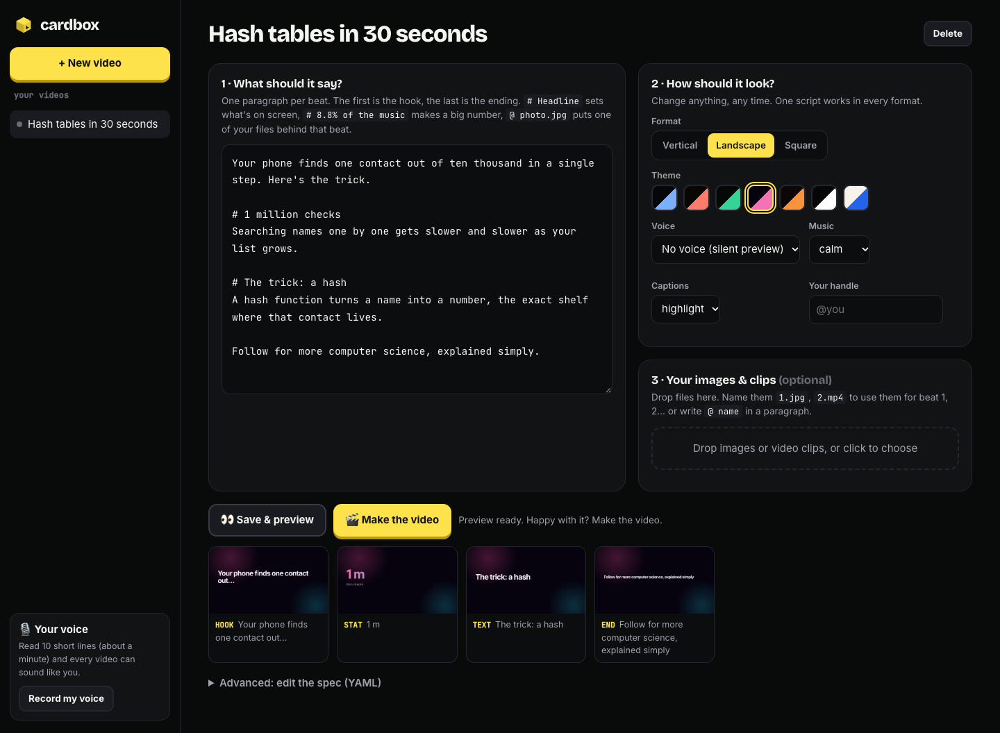

<p align="center">
  
</p>

<h1 align="center">cardbox</h1>

<p align="center">
  <b>Script in. Video out. In your own voice.</b><br>
  Narrated, captioned, animated videos for Reels, Shorts, YouTube and LinkedIn from plain text.<br>
  No paid AI needed, and your AI assistant can drive it over MCP when you want more.
</p>

<p align="center">
  <a href="https://aryainguz.github.io/cardbox">Website</a> ·
  <a href="#quick-start">Quick start</a> ·
  <a href="#use-it-from-your-ai-assistant-mcp">MCP</a> ·
  <a href="docs/spec.md">Spec reference</a> ·
  <a href="server/">Render API</a>
</p>

<p align="center">
  
  
  
  
</p>

---

https://github.com/aryainguz/cardbox/raw/main/site/media/cardbox-explainer.mp4

> **This explainer was made with cardbox.** The visuals and music are cardbox; the narration is my cloned voice, recorded in about a minute.

## No paid AI needed

cardbox's core needs **no paid AI, no API keys and no account**. Write what you want to say in plain text, pick a look, and it makes the video on your own computer, voice included.

**Want more?** Connect your AI assistant (Claude, Cursor or any MCP client). It can write the script from one sentence, find openly licensed images, pick animated scenes and time them to your words, and check preview frames before rendering.

| | Without AI (free, the core) | With your AI assistant (optional) |
| --- | --- | --- |
| Script | You write plain text | Written from one sentence |
| Visuals | Templates, themes, your own images and clips | + licensed image search, scene choice, word-timed animations |
| Voice | Your cloned voice, or the computer's voice | Same |
| Cost | Free | Whatever your assistant costs |

## Why cardbox

Making a short explainer video by hand means scripting, recording, re-recording the line you fluffed, cutting, captioning, animating and syncing it all. With cardbox you either **ask your AI assistant** for the video, or **write what you want to say**:

```text
One step. Any size. Your phone finds one contact out of ten thousand in a single step.

# 1 million checks
Searching names one by one gets slower as your list grows.

# 1 step, at any size
A hash table turns a name into the exact shelf where it lives.

Follow for more computer science, explained simply.
```

```bash
cardbox make script.txt --format vertical --voice me --render     # → script.mp4 + caption.txt (or just use the app)
```

Each paragraph becomes one beat. The first is the hook, the last is the closing card, a `# headline` sets what's on screen, and a headline that starts with a number becomes a big stat card.

Want full control (animated scenes, images, word-timed animations)? The same video as a spec:

```yaml
title: How a hash table finds anything instantly
format: vertical          # vertical · landscape · square
theme: midnight           # 7 themes, or any accent color
voice: me                 # your cloned voice · system · none
beats:
  - kind: hook
    text: One step. Any size.
    say: Your phone finds one contact out of ten thousand in a single step.
  - kind: scene
    scene: counter
    head: So the lookup is
    say: Finding Priya takes one step, whether you have ten contacts or ten million.
    params: {to: 1, label: step, on: one}      # fires the moment you say "one"
  - kind: end
    text: Follow for more
    say: Follow for more computer science, explained simply.
```

## What makes it different

- 🎙️ **Your voice, cloned on your machine.** Read ten short lines in a browser page (about a minute), and every video is narrated in your voice. A consent statement is the first thing recorded.
- 👂 **It checks its own narration.** Every line is transcribed with Whisper and compared with the script. If a word came out slurred or skipped, cardbox re-records that line with a new seed. No more listening to every take.
- ⏱️ **Animations land on the word.** `on: billion` starts a counter the instant you say "billion". Captions highlight each word as it's spoken.
- 🤖 **An MCP server, built in.** Claude, Cursor or any MCP client can write the script, **look at preview frames** before rendering, find images, walk you through voice recording, and render.
- 🖼️ **License-safe images.** Search Openverse and Wikimedia Commons for reusable images only (CC0, public domain, CC BY, CC BY-SA). Credits are written into the post caption automatically.
- 📐 **One script, every platform.** `format: landscape` re-lays out every beat for YouTube; `square` for the LinkedIn feed.
- 🎵 **A soundtrack with no licensing questions.** A music bed is synthesized for each video (calm, upbeat or tense), with a hit on every cut and ducking under the voice.
- 🛠️ **Runs as a service.** A Go [render API](server/) with a worker pool, live progress over SSE, signed webhooks, idempotency and Prometheus metrics.

## Quick start

Requirements: Python 3.10+, `ffmpeg`, and Chrome or Chromium.

```bash
pip install cardbox-video
python -m playwright install chromium   # skip if Google Chrome is installed
cardbox                                 # opens the app in your browser
```

<p align="center"></p>

The app does everything without commands. You write the script, pick a format, theme, voice and music, drop in your own images or clips, record your voice, preview every frame, and render. You can then watch the video, download it and copy its caption. Your videos live in `~/Cardbox`, shared with the CLI and the MCP server.

**Your own voice.** Click *Record my voice* in the app (about a minute of reading). Cloning needs the voice extras:

```bash
pip install "cardbox-video[voice]"            # Chatterbox + Whisper (PyTorch; Apple Silicon or a GPU recommended)
```

> The voice stack is heavy. To keep PyTorch out of your main environment, install `cardbox-video[voice]` in a separate one and point `CARDBOX_VOICE_PYTHON` at its interpreter.

**Your own images and clips.** Drop them into the app, or into the video's `media/` folder. Name them `1.jpg`, `2.mp4`, … to use them for beat 1, 2, … or write `@ photo.jpg` inside a paragraph.

### Prefer the terminal?

```bash
cardbox make script.txt --format landscape --voice me --render   # plain text → video
cardbox new my-video && cardbox render my-video                   # a full YAML spec
cardbox preview my-video 1                                        # a PNG of beat 1
cardbox voice record me                                           # the recording studio
cardbox doctor                                                    # check your setup
```

## Tutorial

A complete walkthrough, recorded live on a laptop: installing, the app, writing a script, formats and themes,
your own images, previewing, rendering, voice recording, the YAML spec, MCP and the CLI. The narration is the
author's cloned voice.

The recording itself is reproducible: [`tutorial/record.py`](tutorial/record.py) drives the real app in Chrome,
runs the real commands, and narrates with a recorded voice.

## Use it from your AI assistant (MCP)

Add cardbox to your client's MCP config:

```json
{
  "mcpServers": {
    "cardbox": { "command": "cardbox", "args": ["mcp"] }
  }
}
```

- **Claude Desktop:** `claude_desktop_config.json` · **Claude Code:** `claude mcp add cardbox -- cardbox mcp` · **Cursor:** `.cursor/mcp.json`

Then just ask: *"Make a 40-second vertical video explaining how DNS works, in my voice."*

| Tool | What it does |
| --- | --- |
| `make_video` | Plain-text script in, video spec out: the quickest start |
| `guide` | How to write a good video: spec format, scenes, writing rules |
| `create_reel` / `get_reel` / `list_reels` | Save and read specs (validation errors come back in plain English) |
| `preview_beat` | Returns a **frame image** so the assistant can see its work before rendering |
| `render_reel` | Renders the MP4 and the post caption, and flags lines the voice may have fumbled |
| `search_images` / `add_image` | Openly licensed images, downloaded and credited |
| `voice_status` / `voice_record` / `voice_test` | Record, check and try your cloned voice |
| `find_icons` / `spec_schema` | 1,900 Lucide icons; the full JSON Schema |

## Formats, themes and styles

| Option | Values |
| --- | --- |
| `format` | `vertical` 1080×1920 (Reels, Shorts, TikTok) · `landscape` 1920×1080 (YouTube, LinkedIn) · `square` 1080×1080 (feeds) |
| `theme` | `midnight` · `ember` · `forest` · `neon` · `sunset` · `mono` · `paper` (light) |
| `accent` | any hex color, overriding the theme's accent |
| `font` | `sans` (Inter) · `mono` (JetBrains Mono) |
| `captions` | `highlight` · `box` · `minimal` · `none` |
| `music` | `calm` · `upbeat` · `tense` · `none` |

**Beat kinds:** `hook`, `text`, `stat`, `list`, `scene`, `end`. Hooks and text beats can take a `background` (an image with a slow push-in, or any scene).

**Scenes (13):** `counter` · `donut` · `bars` · `flow` · `terminal` · `mesh` · `grid` · `photo` · `logo` · `chat` · `script` · `voice` · `formats`. See [docs/spec.md](docs/spec.md) for every parameter.

**Pronunciation:** captions show `say`, but the voice reads `pronounce` when you set it. Write `say: SongsPK` with `pronounce: Songs P K`.

## Render API (Go)

[`server/`](server/) is an HTTP service that queues renders and streams progress:

```bash
cd server && go run ./cmd/cardbox-server     # or: docker compose up
curl -X POST localhost:8080/v1/renders -H "Content-Type: application/yaml" --data-binary @video.yaml
curl -N localhost:8080/v1/renders/<id>/events   # live progress (SSE)
```

It has a bounded worker pool with backpressure, cancellation, graceful drain, SQLite persistence with crash recovery, idempotency keys, reuse of identical renders, HMAC-signed webhooks with retries, API keys, per-key rate limits and Prometheus metrics. Details are in [server/README.md](server/README.md).

## How it works

```
spec.yaml ─► voice (clone · verify with Whisper · retry) ─► word timings
          ─► cards (HTML) + scenes (canvas, cued to words) in a headless browser
          ─► per-beat clips (captions word by word, progress bar) ─► concat
          ─► synthesized music, ducked under the voice ─► video.mp4 + caption.txt
```

Everything runs locally. Your recordings and your voice model never leave your machine.

## Responsible use

Voice cloning is powerful. cardbox records a consent statement as the first take of every voice profile, and won't build a voice without it. **Only clone your own voice, or a voice you have explicit permission to use.** Don't use cardbox to impersonate anyone or to mislead people about who is speaking.

## Contributing

New scenes, themes and caption styles are the easiest place to start: each scene is a single function in [`src/cardbox/scenes/library.js`](src/cardbox/scenes/library.js). See [CONTRIBUTING.md](CONTRIBUTING.md).

## Credits

- [Chatterbox](https://github.com/resemble-ai/chatterbox) (MIT) for voice cloning, and [Whisper](https://github.com/openai/whisper) (MIT) for listening back.
- [Lucide](https://lucide.dev) icons (ISC), plus [Inter](https://rsms.me/inter/) and [JetBrains Mono](https://www.jetbrains.com/lp/mono/) (SIL OFL).
- [Openverse](https://openverse.org) and [Wikimedia Commons](https://commons.wikimedia.org) for openly licensed images.

MIT licensed.
